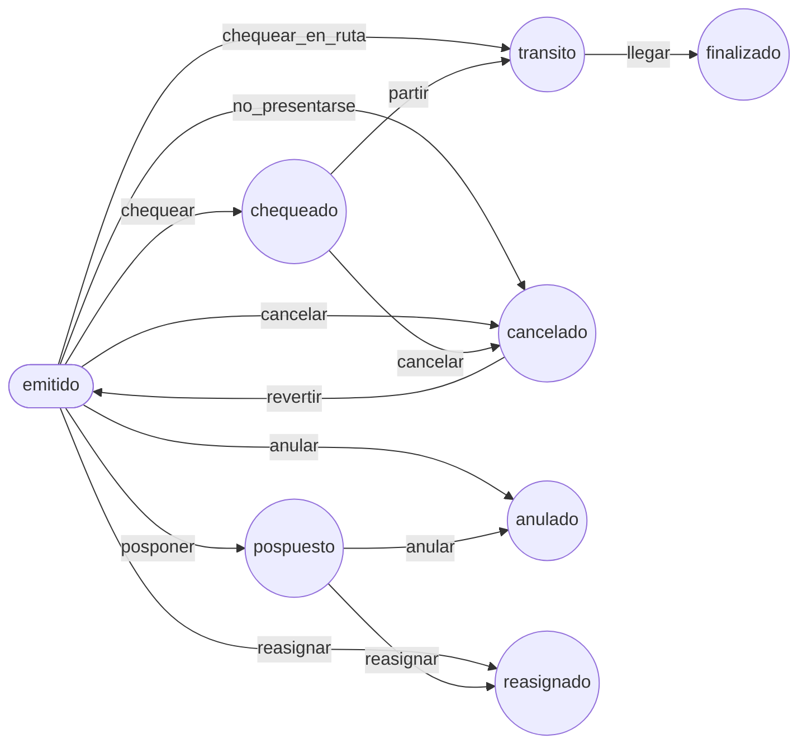

# ADR-037: Flujo del boleto con `symfony/workflow`: transiciones con nombre, guards y acciones calculadas por el backend

**Estado:** Aceptada (reemplaza en parte a ADR-014 para `BoletoAsiento`)

## Contexto

ADR-014 llevó los estados de `BoletoAsiento` a un enum con sus transiciones permitidas (`emitido → chequeado`, …) validadas en `setEstado()`, y dejó escrito cuándo convenía pasar a `symfony/workflow`: *si en el futuro se necesitan guards más complejos (eventos, permisos por transición, auditoría de transición)*. Con el abordaje (ADR-032), el listado de boletos (ADR-033), posponer y la bitácora (ADR-028) esas necesidades llegaron, resueltas a mano y repartidas:

- **El enum decía qué pares de estados se permiten, no qué operación los causa.** `emitido → cancelado` es tanto «no se presentó» (chequeo NO, iniciar, finalizar) como «cancelado desde el listado»; `RegistradorBitacora` adivinaba la operación por el estado nuevo.
- **Las reglas de cada operación vivían en cada servicio** (`Abordaje`, `AnulacionBoletos`, `ReasignacionBoletos`, `GestionCompraWeb`): cada uno comprobaba la venta confirmada, el estado de la salida y la hora antes de llamar a `setEstado()`, y anotaba el motivo en la bitácora por su cuenta.
- **El frontend copiaba esas reglas** para habilitar los botones del panel de `/boletos` (`core/boleto/listado.ts`: «solo se cancela un boleto emitido o chequeado», «la salida ya pasó su hora»…). Cualquier cambio en PHP dejaba la pantalla desfasada, y lo que no se podía ver desde la fila (la ventana de chequeo) no lo mostraba.

## Decisión

### La máquina: `symfony/workflow`, definida desde un enum

- Se agrega `symfony/workflow` (8.1). El workflow `boleto_asiento` es un `state_machine` con marking store por método sobre `BoletoAsiento::$estado` (el componente acepta enums respaldados: lee `getEstado()` y llama `setEstado(EstadoBoletoAsiento::from(...))`).
- **Las transiciones con nombre son un enum**, `App\Entity\Enum\TransicionBoleto`, con su origen (`desde()`) y destino (`hacia()`):

  | Transición | Desde | Hacia | Quién la causa |
  | --- | --- | --- | --- |
  | `chequear` | emitido | chequeado | chequeo SI con la salida abordando |
  | `chequear_en_ruta` | emitido | tránsito | chequeo SI con la salida ya iniciada |
  | `partir` | chequeado | tránsito | iniciar la salida (o finalizar una migrada) |
  | `llegar` | tránsito | finalizado | finalizar la salida |
  | `no_presentarse` | emitido | cancelado | chequeo NO, iniciar (sube en el origen) o finalizar sin chequear |
  | `cancelar` | emitido, chequeado | cancelado | «Cancelar» del listado |
  | `revertir` | cancelado | emitido | «Revertir» del listado |
  | `anular` | emitido, pospuesto | anulado | anulación (ADR-028) |
  | `reasignar` | emitido, pospuesto | reasignado | reasignación (ADR-028) |
  | `posponer` | emitido | pospuesto | «Posponer» del dashboard de la página |

- La configuración está en PHP (`config/packages/workflow.php`, no YAML) para que salga de ese enum: lugares = `EstadoBoletoAsiento::cases()`, transiciones = `TransicionBoleto::cases()`. `EstadoBoletoAsiento::transicionesPermitidas()` también sale de él, y `setEstado()` sigue rechazando un par que ninguna transición une: es la última barrera si alguien se salta el workflow. Una sola definición, sin copias que se desincronicen (lo comprueba `FlujoBoletoTest`).
- `bin/console workflow:dump boleto_asiento --dump-format=mermaid` dibuja el diagrama:

### Guards: qué exige cada transición (`App\Venta\Boleto\Flujo`)

- **`ReglasTransicion`** (puro): lo que cada transición exige además del estado del boleto, que ya lo asegura la máquina. Venta confirmada para las que opera una persona (`chequear*`, `cancelar`, `anular`, `reasignar`, `posponer`); el estado de la salida (`no_presentarse` desde que aborda, `partir` con la salida iniciada o finalizada, `llegar` con la salida finalizada); y las reglas que ya existían, reutilizadas tal cual: `ReglasAbordaje::exigirChequeable` (ventana de 2 h antes a 30 h después), `exigirCancelable`, `exigirRevertible` (ni cortesía ni agencia) y `ReglasBoletos::exigirOperable` (antes de la hora de salida, o pospuesto).
- **`GuardiaBoleto`** escucha `workflow.boleto_asiento.guard` y bloquea con el mensaje y el código de la regla. La excepción original va en el bloqueo.
- **`FlujoBoleto`** es el único camino para cambiar el estado: `aplicar()`, `exigir()`, `puede()`, `rechazo()` y `acciones()`. Un rechazo es la misma `SalidaRechazada` (abordaje) o `VentaRechazada` (anular, reasignar, posponer) que se lanzaba antes, con su código y estado HTTP: los controladores no cambian. Si lo bloquea el estado del boleto, el mensaje se arma con lo que la transición exige: «El boleto 27640 (asiento 9) está cancelado: solo se cancela un boleto emitido o chequeado.» (409, `boleto_no_cancelable`).

### Qué queda fuera del workflow, a propósito

**Quién pide la transición y lo que se consulta en la base no son guards:**

- **Permisos** (`boleto.cancelar`, `boleto.anular`, `boleto.reasignar`, `boleto.chequear`) y **estación** (la que chequea es la estación donde sube el pasajero): los siguen comprobando el controlador y el servicio. `partir`, `llegar` y `no_presentarse` las causan la salida, la consola y la migración, sin un usuario detrás; un guard con `is_granted()` las rompería o tendría que dejar pasar «sin usuario», que es peor.
- **Lo que necesita la base y el bloqueo de la salida**: que el asiento siga libre al revertir (`Ocupacion` + `Disponibilidad`), que la factura cubra toda la venta (`exigirVentaCompleta`), la empresa y el precio de la salida destino al reasignar. Cada servicio sigue bloqueando la salida (`PESSIMISTIC_WRITE`) antes de aplicar la transición: el workflow decide si el boleto la admite; la transacción y el bloqueo evitan las carreras.

### Bitácora

`RegistradorBitacora` escucha `workflow.boleto_asiento.transition` y anota en el detalle de la próxima entrada del boleto el nombre de la transición (`transicion`) y lo que el servicio pasó en el contexto (`RegistradorBitacora::CONTEXTO`: motivo, salida y asiento destino de la reasignación; la misma clave sirve al workflow de la encomienda, ADR-038). La entrada la sigue escribiendo el listener de Doctrine en la misma transacción, y la operación (`OperacionBoleto`) no cambia: las entradas viejas y la pantalla de bitácora siguen igual. Los servicios ya no llaman a `anotar()` para un cambio de estado.

### Acciones del listado calculadas por el backend

Cada fila de `GET /api/boletos` (y el detalle) trae `acciones: { chequear, cancelar, revertir, anular, reasignar }`: `null` si el boleto la admite ahora, o el motivo (`FlujoBoleto::acciones`, con «chequear» según la salida: `TransicionBoleto::alChequear`). El frontend (`core/boleto/listado.ts`) ya no repite las reglas: suma el permiso de quien mira (`puede`, de `/api/boletos/opciones`) y decide solo lo que no es transición (correo, reimprimir factura). Lo que depende de quién y de la base lo valida el backend al operar.

### Acciones del dashboard de compras web

En `GET /api/pagina/compras` cada boleto de cada viaje trae `acciones: { anular, reasignar, posponer }` (`FlujoBoleto::motivos`; `ConsultaComprasWeb` carga las entidades de la página en una consulta). El dashboard (`core/pagina-web/acciones.ts`) las junta por compra: «Anular» toma los boletos que admiten `anular`, «Reasignar» ofrece los viajes con boletos que admiten `reasignar` y «Posponer» se habilita si alguno admite `posponer`. Si ninguno la admite muestra el motivo del backend cuando es el mismo para todos (un solo boleto, la misma salida) y uno general si no. El frontend ya no compara la hora de salida con el reloj del navegador. Un boleto de una salida de otra empresa (filtro de empresa del usuario, ADR-015) no se carga y no se opera.

## Consecuencias

**Positivas:**

- Las reglas de cada operación del boleto están en un lugar (`ReglasTransicion`), con nombre, y el frontend las recibe ya evaluadas: un cambio en PHP llega solo a la pantalla, también lo que antes no se veía desde la fila (la ventana de chequeo).
- La bitácora sabe qué operación ocurrió (`cancelar` frente a `no_presentarse`).
- Eventos para lo que viene después (`entered`, `completed`): Mercure, avisos del chat o el correo pueden engancharse a una transición sin tocar los servicios.
- El diagrama sale del código (`workflow:dump`).

**Negativas:**

- Una dependencia nueva y un segundo patrón de estados en el proyecto: `Salida`, `PagoWeb` y `AgenciaDeposito` siguen con enums (ADR-014). `Encomienda` pasó al mismo patrón en ADR-038.
- Los guards se evalúan en cada `can()`/`apply()`: el listado los corre cinco veces por fila, y el dashboard tres por boleto. Son puros y sobre lo que ya está cargado (salida, venta), sin consultas.
