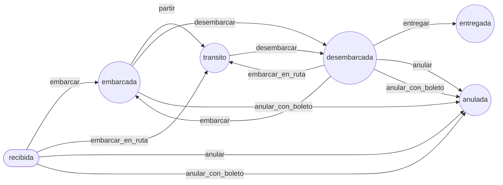

# ADR-038: Flujo de la encomienda con `symfony/workflow`

**Estado:** Aceptada (reemplaza las transiciones de estado de ADR-035)

## Contexto

ADR-037 llevó el boleto a un `state_machine` de `symfony/workflow` y dejó a `Encomienda` como la siguiente candidata. Tenía los mismos síntomas que el boleto antes de ese cambio:

- **El enum decía qué pares se permiten, no qué operación los causa.** `recibida → anulada` es tanto «Anular» (no ha viajado) como la anulación de la venta de un pasajero que la llevaba; `desembarcada → embarcada` es un transbordo; `embarcada → transito`, iniciar la salida.
- **Las reglas estaban repartidas.** `ReglasEncomienda` mezclaba en cada función lo que se sabe de la encomienda (en bodega, en su origen, con boleto), lo de la operación (la salida en que se embarca, la parada donde se baja) y quién opera (la estación del usuario); `MovimientosEncomienda` llamaba a `setEstado()` y anotaba la bitácora a mano.
- **El frontend copiaba las reglas** para habilitar los botones de `/encomiendas` (`core/encomienda/reglas.ts`), y tenía una que el backend no exigía: no embarcar una encomienda que ya está en su destino.

## Decisión

### La máquina: el workflow `encomienda`, definido desde un enum

Igual que ADR-037: `state_machine` con marking store por método sobre `Encomienda::$estado`, configurado en `config/packages/workflow.php` desde el enum `App\Entity\Enum\TransicionEncomienda`. `EstadoEncomienda::transicionesPermitidas()` sale del mismo enum, y `setEstado()` sigue siendo la última barrera. Las transiciones cubren exactamente los pares que permitía el enum de ADR-035 (lo comprueba `FlujoEncomiendaTest`):

| Transición | Desde | Hacia | Quién la causa |
| --- | --- | --- | --- |
| `embarcar` | recibida, desembarcada | embarcada | embarcar en una salida que todavía no inicia |
| `embarcar_en_ruta` | recibida, desembarcada | tránsito | embarcar en una salida ya iniciada (parada intermedia) |
| `partir` | embarcada | tránsito | iniciar la salida (abordaje, ADR-032) |
| `desembarcar` | embarcada, tránsito | desembarcada | bajarla en una parada (su destino o un transbordo), o al entregarla si llegó en tránsito |
| `entregar` | desembarcada | entregada | la retira el destinatario en su destino |
| `anular` | recibida, desembarcada | anulada | «Anular»: no ha viajado |
| `anular_con_boleto` | recibida, embarcada, desembarcada | anulada | se anulan todos los boletos de la venta que la lleva (ADR-028) |

### Guards: lo que se sabe de la encomienda (`ReglasEncomienda::rechazo`)

`GuardiaEncomienda` escucha `workflow.encomienda.guard` y bloquea con la regla pura de cada transición:

- `embarcar*`: está en la bodega de una estación y **no es su destino** (ahí se entrega). Esta regla solo la tenía el frontend; ahora la exige también el backend (código `en_destino`).
- `partir`: su salida está iniciada.
- `desembarcar`: va en una salida.
- `entregar`: está en la bodega de su destino.
- `anular`: no va con boleto (`con_boleto`) y está en la bodega de su origen. `anular_con_boleto`: va con boleto.

`FlujoEncomienda` es el único camino para cambiar el estado (`aplicar`, `exigir`, `puede`, `rechazo`, `rechazoEntrega`, `acciones`). Un rechazo es la `EncomiendaRechazada` de siempre; si lo bloquea el estado, el mensaje sale de lo que exige la transición: «La encomienda está embarcada: solo se anula una encomienda que no ha viajado (en la bodega de su origen).» (422, `estado`).

**Entregar en tránsito** (como el legado: el bus llegó y nadie la bajó en el sistema) son dos transiciones, `desembarcar` en su destino y `entregar`, y la bitácora guarda las dos. `rechazoEntrega()` dice antes de cobrar si se puede: desembarcada en su destino, o en tránsito en una salida que pasa por él.

### Qué queda en el servicio, a propósito

Como en ADR-037, lo que depende de la operación o de quién la pide no es un guard:

- **La salida en que se embarca** (es un dato de la operación, no de la encomienda): abierta, de su empresa y que siga después de la estación (`ReglasEncomienda::exigirSalidaParaEmbarcar`). Embarcar elige la transición por el estado de esa salida (`TransicionEncomienda::alEmbarcar`).
- **La parada donde se baja**: una de su salida (`exigirParadaDeSalida`).
- **Quién opera**: un usuario de la estación (la bodega donde está, su destino al entregar, su origen al anular) o de oficina (`exigirEstacion`), y los permisos `encomienda.*` del controlador.
- El bloqueo de la fila (`PESSIMISTIC_WRITE`), la factura (cobrar al entregar, anularla en el certificador) y la ruta (cambiar de ruta en bodega no es un cambio de estado).

### Bitácora

`RegistradorBitacora` escucha también `workflow.encomienda.transition`: el detalle de la entrada trae `transicion` y lo que el servicio pasa en el contexto (`RegistradorBitacora::CONTEXTO`, la misma clave para los dos workflows: estación, motivo, quién retira). La operación (`OperacionEncomienda`) sigue saliendo del estado nuevo.

### Acciones del listado calculadas por el backend

Cada fila de las consultas de encomiendas (`/api/encomiendas`, pendientes, procesar por salida) trae `acciones: { embarcar, desembarcar, entregar, anular }`: `null` si la encomienda la admite ahora, o el motivo (`FlujoEncomienda::acciones`). El panel de `/encomiendas` (`core/encomienda/reglas.ts`) suma el permiso y la estación de quien mira; el backend vuelve a exigir todo al operar.

## Consecuencias

**Positivas:**

- Las operaciones de la encomienda tienen nombre y sus reglas, un lugar; el frontend las recibe ya evaluadas.
- La bitácora distingue un «Anular» de la anulación con la venta del pasajero, y anota la estación de cada movimiento sin código en los servicios.
- No embarcar lo que ya está en su destino pasa a ser una regla del backend.

**Negativas:**

- Para entregar una encomienda en tránsito, `acciones` lee las paradas de su salida: es una consulta por salida distinta en la página, no por fila (Doctrine las cachea en la petición).
- `Salida`, `PagoWeb` y `AgenciaDeposito` siguen con enums (ADR-014): sus transiciones son lineales o tienen una sola operación por par, y el workflow no aportaría tanto.
